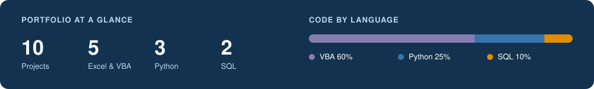

<div align="center">


<br>

[](https://www.linkedin.com/in/swaminathan-narayanan-9781a7154/)


</div>

## 👋 About me

```sql
SELECT role, experience, speciality, currently_building
FROM   swaminathan
WHERE  goal = 'replace manual reporting with one click';
```

| role | experience | speciality | currently_building |
|---|---|---|---|
| Data Analytics Professional | 10+ years | Excel & VBA automation, SQL, Python, Power BI | A library of real-world projects: automation, ETL pipelines and data science |

I turn messy data into clear reports, dashboards and automated workflows. My work is about saving time: finding the manual, repetitive steps in a reporting process and replacing them with tools that run in minutes.

Everything here is **practical and documented**: each project starts from a business problem, includes sample data, and explains how to run it.

## 🧭 From raw file to decision

Each project covers one stage of the reporting journey, so together they form a complete toolkit.

<p align="center"><b>📥 Collect &nbsp;→&nbsp; 🧹 Clean &nbsp;→&nbsp; 🔗 Consolidate &nbsp;→&nbsp; ⚖️ Reconcile &nbsp;→&nbsp; 🧮 Analyse &nbsp;→&nbsp; 🔮 Predict &nbsp;→&nbsp; 📄 Report &nbsp;→&nbsp; ✉️ Distribute &nbsp;→&nbsp; 📊 Dashboard</b></p>

| Stage | Project |
|---|---|
| 📥 Collect | [PDF Invoice Extractor](https://github.com/Swami529796/python-pdf-invoice-extractor), [Sales Data Warehouse ETL](https://github.com/Swami529796/etl-sales-data-warehouse) and [FX Rates ETL](https://github.com/Swami529796/etl-fx-rates-pipeline) (Python + SQL) |
| 🧹 Clean | [Data Cleaning Toolkit](https://github.com/Swami529796/excel-data-cleaning-toolkit) (VBA ribbon add-in) |
| 🔗 Consolidate | File Consolidator in [VBA](https://github.com/Swami529796/excel-file-consolidator) and [Python](https://github.com/Swami529796/python-file-consolidator) |
| ⚖️ Reconcile | [Data Reconciliation Tool](https://github.com/Swami529796/excel-data-reconciliation) (VBA) |
| 🧮 Analyse | [SQL Sales Analytics](https://github.com/Swami529796/sql-sales-analytics) and [Customer Segmentation Pipeline](https://github.com/Swami529796/sql-python-customer-segmentation) (SQL + Python) |
| 🔮 Predict | [Sales Forecasting](https://github.com/Swami529796/sales-forecasting-python) and [Customer Churn Prediction](https://github.com/Swami529796/customer-churn-prediction) (Python, scikit-learn) |
| 📄 Report | Report Generator in [VBA](https://github.com/Swami529796/excel-report-generator) and [Python](https://github.com/Swami529796/python-report-generator) |
| ✉️ Distribute | [Excel Report Distributor](https://github.com/Swami529796/python-excel-report-distributor) (Python: one workbook and email draft per person) |
| 📊 Dashboard | [Sales Dashboard](https://github.com/Swami529796/sales-dashboard-flask) (Flask + Excel) |
| 🧰 Foundation | [VBA Utilities Library](https://github.com/Swami529796/vba-utilities-library) (logging, error handling, arrays, files) |

## 🛠️ Toolbox


## 🚀 Projects

> This section writes itself. A GitHub Action reads my public repositories every day and rebuilds the tables below, so a newly published project appears here automatically.

<!--START:projects-->
### 📗 Excel &amp; VBA

| Project | What it does | Built with | Updated |
|---|---|---|---|
| **[VBA Utilities Library](https://github.com/Swami529796/vba-utilities-library)** | Reusable VBA modules for logging, error handling, arrays, files, sheets and text, with an 80-check built-in test suite. | `automation` `excel` `library` `utilities` `vba` | 14 Nov 2026 |
| **[Excel File Consolidator](https://github.com/Swami529796/excel-file-consolidator)** | Merge every Excel/CSV file in a folder into one master sheet with header validation, source tracking and an audit log. VBA. | `automation` `data-consolidation` `excel` `vba` | 14 Nov 2026 |
| **[Excel Data Cleaning Toolkit](https://github.com/Swami529796/excel-data-cleaning-toolkit)** | Custom Excel ribbon tab with one-click data cleaning: trim, fix dates, text to numbers, remove duplicates, fill blanks, split columns and undo. VBA. | `add-in` `automation` `data-cleaning` `excel` `ribbon` | 14 Nov 2026 |
| **[Excel Data Reconciliation](https://github.com/Swami529796/excel-data-reconciliation)** | Compare two datasets on a key in Excel: flags matches, mismatches (with the differing columns), missing records and duplicates. VBA. | `automation` `data-quality` `excel` `reconciliation` `vba` | 14 Nov 2026 |
| **[Excel Report Generator](https://github.com/Swami529796/excel-report-generator)** | Build a formatted monthly PDF report per region with KPIs, product breakdown and trend chart, plus Outlook drafts. VBA. | `automation` `excel` `outlook` `reporting` `vba` | 31 Oct 2026 |

### 🐍 Python

| Project | What it does | Built with | Updated |
|---|---|---|---|
| **[Sales Dashboard Flask](https://github.com/Swami529796/sales-dashboard-flask)** | Interactive sales dashboard that reads straight from an Excel workbook: Flask, pandas and Chart.js with filters and period comparison. | `chartjs` `dashboard` `excel` `flask` `pandas` | 14 Nov 2026 |
| **[Python Report Generator](https://github.com/Swami529796/python-report-generator)** | Generate a one-page PDF sales report per region with KPIs, product breakdown and trend chart. Python rebuild of my VBA report generator. | `automation` `matplotlib` `pandas` `pdf` `python` | 14 Nov 2026 |
| **[Python File Consolidator](https://github.com/Swami529796/python-file-consolidator)** | Merge every Excel/CSV file in a folder into one master workbook with header validation and an audit log. Python rebuild of my VBA consolidator. | `automation` `data-consolidation` `excel` `openpyxl` `pandas` | 14 Nov 2026 |
| **[Python Excel Report Distributor](https://github.com/Swami529796/python-excel-report-distributor)** | Split a master workbook into one formatted Excel report per person and prepare an email draft for each, with the report attached. | `automation` `excel` `openpyxl` `python` `reporting` | 14 Nov 2026 |
| **[Python PDF Invoice Extractor](https://github.com/Swami529796/python-pdf-invoice-extractor)** | Extract invoice data from PDFs in different vendor layouts into Excel, with arithmetic checks, duplicate detection and an issues log. | `automation` `invoice-processing` `pandas` `pdf` `python` | 14 Nov 2026 |

### 🗄️ SQL

| Project | What it does | Built with | Updated |
|---|---|---|---|
| **[SQL Python Customer Segmentation](https://github.com/Swami529796/sql-python-customer-segmentation)** | ETL pipeline: cleans a messy order export, loads SQLite, segments customers with SQL (RFM, cohorts) and outputs charts plus an Excel workbook. | `etl` `pandas` `python` `rfm-analysis` `sql` | 14 Nov 2026 |
| **[SQL Sales Analytics](https://github.com/Swami529796/sql-sales-analytics)** | 27 business questions answered in SQL: window functions, CTEs, RFM segmentation, cohort retention, Pareto and market basket analysis. | `analytics` `data-analysis` `sql` `sqlite` `window-functions` | 14 Nov 2026 |

### 🔄 ETL &amp; Data Pipelines

| Project | What it does | Built with | Updated |
|---|---|---|---|
| **[ETL FX Rates Pipeline](https://github.com/Swami529796/etl-fx-rates-pipeline)** | Incremental ETL from a public exchange-rate API into SQLite, used to convert multi-currency invoices to INR at the rate on each invoice date. | `api` `data-engineering` `etl-pipeline` `python` `sqlite` | 14 Nov 2026 |
| **[ETL Sales Data Warehouse](https://github.com/Swami529796/etl-sales-data-warehouse)** | Incremental ETL pipeline: CSV, Excel and JSON sources into a star-schema warehouse, with idempotent loads, rejected-row tracking and quality checks. | `data-engineering` `data-warehouse` `etl-pipeline` `python` `sqlite` | 14 Nov 2026 |

### 🤖 Data Science

| Project | What it does | Built with | Updated |
|---|---|---|---|
| **[Customer Churn Prediction](https://github.com/Swami529796/customer-churn-prediction)** | Customer churn model with scikit-learn: ranks customers by risk, explains the drivers and sizes the retention campaign that pays off. | `churn-prediction` `data-science` `machine-learning` `python` `scikit-learn` | 14 Nov 2026 |
| **[Sales Forecasting Python](https://github.com/Swami529796/sales-forecasting-python)** | Monthly sales forecasting: backtests three models per category, picks the most accurate and forecasts six months with an 80% range. | `data-science` `forecasting` `python` `scikit-learn` `time-series` | 14 Nov 2026 |
<!--END:projects-->

## ⚔️ Same problem, two tools

I rebuild my VBA projects in Python to compare the two approaches honestly. Neither always wins.

| Problem | VBA | Python | What I learned |
|---|---|---|---|
| Merge many Excel/CSV files | [excel-file-consolidator](https://github.com/Swami529796/excel-file-consolidator) | [python-file-consolidator](https://github.com/Swami529796/python-file-consolidator) | Same 120 rows from the same files. Python took 0.3 sec against 8.6 sec and comes with automated tests; VBA needs nothing installed. |
| Monthly PDF report per region | [excel-report-generator](https://github.com/Swami529796/excel-report-generator) | [python-report-generator](https://github.com/Swami529796/python-report-generator) | VBA lets the team adjust the layout in Excel and creates Outlook drafts; Python runs unattended on a schedule. |

**Rule of thumb:** VBA when the user must stay inside Excel, Python when it has to be fast, tested or scheduled.

## 📊 At a glance



## 🕒 Latest activity

<!--START:activity-->
- `14 Nov 2026` &nbsp; **[vba-utilities-library](https://github.com/Swami529796/vba-utilities-library)**: Add VBA Utilities Library: seven modules, test workbook and docs
- `14 Nov 2026` &nbsp; **[excel-file-consolidator](https://github.com/Swami529796/excel-file-consolidator)**: Add working FileConsolidator workbook with macro
- `14 Nov 2026` &nbsp; **[excel-data-cleaning-toolkit](https://github.com/Swami529796/excel-data-cleaning-toolkit)**: Add Data Cleaning Toolkit: VBA, ribbon tab, sample workbook and docs
- `14 Nov 2026` &nbsp; **[excel-data-reconciliation](https://github.com/Swami529796/excel-data-reconciliation)**: Add Data Reconciliation Tool: VBA, sample workbook and docs
- `14 Nov 2026` &nbsp; **[sales-dashboard-flask](https://github.com/Swami529796/sales-dashboard-flask)**: Add Sales Dashboard: Flask app, sample workbook, tests and docs
<!--END:activity-->

## 📫 Let's connect

I'm always glad to talk with fellow data and automation professionals.

[](https://www.linkedin.com/in/swaminathan-narayanan-9781a7154/)

<!--START:updated-->
<sub>🔄 Project list and stats last refreshed automatically on 15 Nov 2026 by a GitHub Action in this repository.</sub>
<!--END:updated-->
